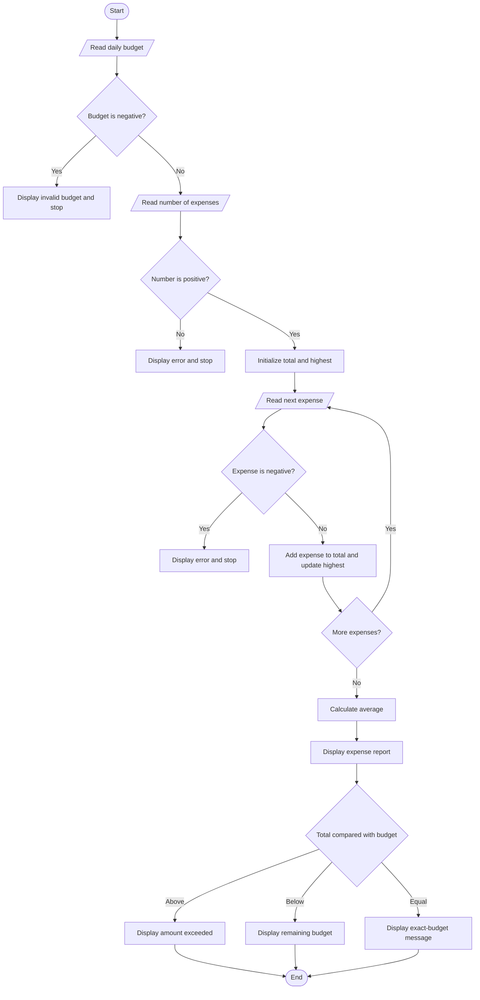

# Challenge 04 - Daily Expense Tracker

A C program that summarizes daily expenses and compares the total with a user-provided budget.

## Problem statement

Read a daily budget and a positive number of expenses. Calculate the total, average, and highest expense, then report whether the total is below, equal to, or above the budget.

## Algorithm

1. Start.
2. Read the daily budget. If it is negative, display an error and stop.
3. Read the number of expenses. If it is not positive, display an error and stop.
4. Initialize the total to zero and read each expense in a loop.
5. If an expense is negative, display an error and stop.
6. Add each expense to the total and track the highest expense.
7. Calculate the average as `total / number of expenses`.
8. Display the budget, total, average, and highest expense.
9. Compare the total with the budget and display the excess, remaining budget, or an exact-budget message.
10. Stop.

## Flowchart



## Input

- Daily budget (non-negative number)
- Number of expenses (positive integer)
- Each expense (non-negative number)

## Compile and run

```sh
gcc -std=c11 -Wall -Wextra -pedantic challenge04.c -o challenge04
./challenge04
```

On Windows, run `challenge04.exe` after compiling.

## Example

Input values: budget `1000`, 3 expenses: `250`, `400`, and `150`.

```text
--- Daily Expense Report ---
Daily Budget:    Rs. 1000.00
Total Expenses:  Rs. 800.00
Average Expense: Rs. 266.67
Highest Expense: Rs. 400.00
Remaining Budget: Rs. 200.00
```

The corresponding example output is saved in [`output/output.txt`](output/output.txt).
