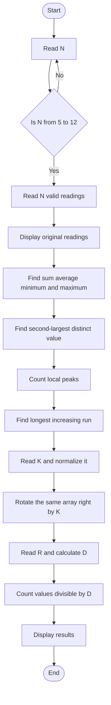

# Challenge 06 Pattern Detective

A beginner-friendly C program that studies a list of smart-campus activity readings.

## What the program does

- Reads 5 to 12 activity readings.
- Checks that every reading is from 0 to 1000.
- Displays the original readings, sum, average, minimum, and maximum.
- Finds the second-largest distinct value.
- Counts local peaks.
- Finds the longest strictly increasing contiguous run.
- Rotates the same array right by `K` positions. A negative `K` rotates left.
- Calculates `D = (R % 9) + 1` using the last two registration-number digits and counts the rotated values divisible by `D`.

The code uses one array only. The rotation is performed in place, without a second array or sorting.

## Algorithm

1. Read `N`. Keep asking until it is between 5 and 12.
2. Use a loop to read `N` activity readings. Keep asking for a reading until it is between 0 and 1000.
3. Display the original readings.
4. Use a loop to find the sum, minimum, and maximum.
5. Use another loop to find the largest value that is different from the maximum. This is the second-largest distinct value.
6. Check every middle value with its left and right neighbour to count local peaks.
7. Compare every value with the previous value to find the longest increasing contiguous run.
8. Read `K`, then use `K % N` to keep the number of rotations between 0 and `N - 1`. If `K` is negative, add `N` so that it becomes a right rotation.
9. Rotate the original array in place. For each shift, move the last value to the first position.
10. Read the last two registration-number digits, calculate `D = (R % 9) + 1`, and count the rotated values divisible by `D`.

## Pseudocode

```text
START
Read N until 5 <= N <= 12

FOR each reading from 0 to N - 1
    Read reading until 0 <= reading <= 1000
END FOR

Find sum, minimum, and maximum
Find second-largest distinct value
Count local peaks
Find longest increasing contiguous run

Read K
Set K = K % N
If K is negative, add N to K
Rotate the array right by K positions

Read R
Set D = (R % 9) + 1
Count rotated values divisible by D
Display all results
END
```

## Flowchart



## Compile and run

With GCC:

```sh
gcc Challenge-06.c -o Challenge-06
./Challenge-06
```

On Windows:

```powershell
.\Challenge-06.exe
```

## Example

For readings `10 20 15 30 25 40 35`, rotation `K = 2`, and registration digits `42`:

- The second-largest distinct value is `35`.
- There are `3` local peaks.
- The longest increasing run has length `2`.
- The rotated readings are `40 35 10 20 15 30 25`.
- `D` is `7`, and one rotated value is divisible by `7`.

## Suggested test cases

| Case | Values to test | What to check |
|---|---|---|
| Normal case | Mixed values with positive K | All calculations and rotation |
| All equal | `5 5 5 5 5` | No second-largest distinct value, no peaks |
| Decreasing | `9 8 7 6 5` | Longest increasing run is 1 |
| Duplicate maximum | `10 50 50 30 20` | Second-largest distinct value is 30 |
| Negative K | Any valid data with `K = -1` | Array rotates left by one |
| Large K | Any valid data with `K` larger than N | K is normalized correctly |
