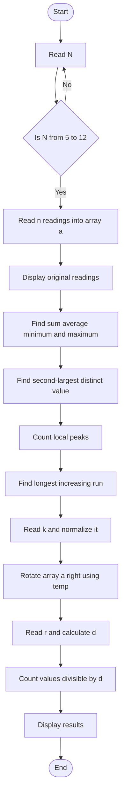

# Challenge 06 Pattern Detective

A beginner-friendly C program that studies a list of smart-campus activity readings.

## What the program does

- Reads the number of activity readings, from 5 to 12.
- Uses `while` loops to ask again when a numeric value is outside the allowed range.
- Stores the readings in an integer array named `a`.
- Displays the original readings, sum, average, minimum, and maximum.
- Finds the second-largest distinct value.
- Counts local peaks.
- Finds the longest strictly increasing contiguous run.
- Rotates the same array right by `K` positions. A negative `K` rotates left.
- Calculates `D = (R % 9) + 1` using the last two registration-number digits and counts the rotated values divisible by `D`.

The code uses one array only. The rotation is performed in place with the `temp` variable, without a second array or sorting.

## Algorithm

1. Read `n`. Use a `while` loop to keep asking until it is between 5 and 12.
2. Use a `for` loop to read `n` activity readings into `a`. Use a `while` loop to keep asking until each reading is between 0 and 1000.
3. Display the original readings.
4. Use a loop to find the sum, minimum, and maximum.
5. Use another loop to find the largest value that is different from the maximum. This is the second-largest distinct value.
6. Check every middle value with its left and right neighbour to count local peaks.
7. Compare every value with the previous value to find the longest increasing contiguous run.
8. Read `k`, then use `k % n` to keep the number of rotations between 0 and `n - 1`. If `k` is negative, add `n` so that it becomes a right rotation.
9. Rotate the original array in place. For each shift, move the last value to the first position.
10. Read `r`, the last two registration-number digits, calculate `d = (r % 9) + 1`, and count the rotated values divisible by `d`.

## Pseudocode

```text
START
Read n
WHILE n is less than 5 or greater than 12
    Read n again
END WHILE

FOR each reading from 0 to n - 1
    Read a[i]
    WHILE a[i] is less than 0 or greater than 1000
        Read a[i] again
    END WHILE
END FOR

Find sum, minimum, and maximum
Find second-largest distinct value
Count local peaks
Find longest increasing contiguous run

Read K
Set k = k % n
If k is negative, add n to k
Rotate a right by k positions using temp

Read r
Set d = (r % 9) + 1
Count rotated values divisible by d
Display all results
END
```

## Flowchart



## Compile and run

With GCC:

```sh
gcc Challenge-06.c -o Challenge-06
./Challenge-06
```

On Windows:

```powershell
.\Challenge-06.exe
```

## Example

For readings `10 20 15 30 25 40 35`, rotation `K = 2`, and registration digits `42`:

- The second-largest distinct value is `35`.
- There are `3` local peaks.
- The longest increasing run has length `2`.
- The rotated readings are `40 35 10 20 15 30 25`.
- `D` is `7`, and one rotated value is divisible by `7`.

## Suggested test cases

| Case | Values to test | What to check |
|---|---|---|
| Normal case | Mixed values with positive K | All calculations and rotation |
| All equal | `5 5 5 5 5` | No second-largest distinct value, no peaks |
| Decreasing | `9 8 7 6 5` | Longest increasing run is 1 |
| Duplicate maximum | `10 50 50 30 20` | Second-largest distinct value is 30 |
| Negative K | Any valid data with `K = -1` | Array rotates left by one |
| Large K | Any valid data with `K` larger than N | K is normalized correctly |
