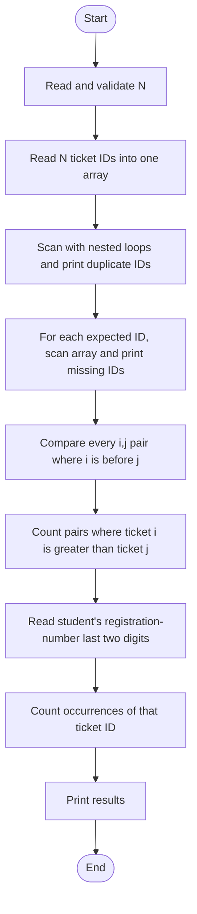

# CODE2THINK Challenge 07 — Ticket Trace

> Learning scaffold only. Read, trace, test, and adapt this program yourself before any assessment. Do **not** submit copied or AI-generated work as your own. You must be able to explain every loop and condition, use your own registration-number last two digits, and follow the exact rules in your Challenge 07 document.

## Important source-document check

The Challenge_07.docx file was not available in this workspace when this scaffold was created. The program follows the brief available in the announcement: find missing and duplicate ticket IDs, count out-of-order pairs, and perform a personalised check. Before use, compare every constraint, range, input format, and personalised rule with the official document and change this work where needed.

## Constraints used

- Only `#include <stdio.h>`.
- One one-dimensional integer array: `ticket[100]`.
- Loops, nested loops, and conditionals only for the analysis.
- No sorting and no second array.
- The input is assumed to contain `n` ticket IDs whose valid expected IDs are `1` through `n`.
- The student enters their own registration-number last two digits at run time. This version counts how many times that value occurs as a ticket ID. Replace this personalised check if the official document states a different rule.

## Algorithm

1. Read `n`, the number of ticket IDs, and validate that it is from 1 to 100.
2. Read `n` ticket IDs into the single array. Validate every ID from 1 to `n`.
3. For each ticket ID, first check whether it occurred earlier. If it did not, scan the later elements; print it if it occurs again. This prints each duplicate once.
4. For every expected ID from 1 to `n`, scan the array. If it is absent, print it as missing.
5. Compare every pair where the left index is smaller than the right index. Count a pair when the left ticket ID is larger; it is an out-of-order pair.
6. Read the student's own registration-number last two digits and count how often that ticket ID appears.
7. Print the results.

## Flowchart



## Compile and run

With GCC:

```sh
gcc Challenge-07.c -o Challenge-07
./Challenge-07
```

On Windows after compiling:

```powershell
.\Challenge-07.exe
```

## Test cases

| Case | `n` and ticket IDs | Registration digits | Expected result to verify |
|---|---|---:|---|
| Mixed case | `5`: `1 3 2 3 5` | `23` | Duplicate `3`, missing `4`, 1 out-of-order pair, personal count 0 |
| No duplicate or missing ID | `4`: `1 2 3 4` | `2` | No duplicate, no missing ID, 0 out-of-order pairs, personal count 1 |
| Reverse order | `4`: `4 3 2 1` | `1` | No duplicate or missing ID, 6 out-of-order pairs, personal count 1 |
| Multiple duplicate values | `6`: `1 1 3 3 5 6` | `3` | Duplicates `1` and `3`, missing `2` and `4`, personal count 2 |

