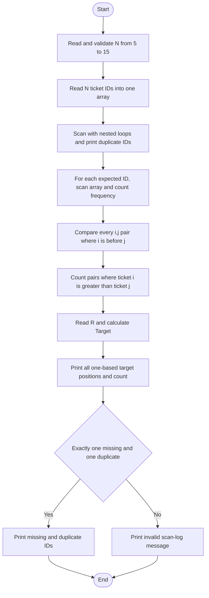

# CODE2THINK Challenge 07 — Ticket Trace

> Learning scaffold only. Read, trace, test, and adapt this program yourself before any assessment. Do **not** submit copied or AI-generated work as your own. You must be able to explain every loop and condition, use your own registration-number last two digits, and follow the exact rules in your Challenge 07 document.

## Constraints used

- Only `#include <stdio.h>`.
- One one-dimensional integer array: `ticket[15]`.
- Loops, nested loops, and conditionals only for the analysis.
- No sorting and no second array.
- `N` must be from 5 through 15, and every ticket ID must be from 1 through `N`.
- A valid scan log has exactly one missing ID and exactly one different ID occurring twice. Other patterns are reported as invalid.
- The student enters their own registration-number last two digits as `R`. The program calculates `Target = (R % N) + 1`, then displays every one-based target position and its occurrence count.

## Algorithm

1. Read `N` and validate that it is from 5 to 15.
2. Read `N` ticket IDs into the single array and validate each ID from 1 to `N`.
3. For each possible ID from 1 to `N`, count its frequency by scanning the array with a nested loop.
4. Record IDs with frequency 0 and frequency 2. Report an invalid log unless there is exactly one of each.
5. Compare every pair where `i < j`; count it when `ticket[i] > ticket[j]`.
6. Read `R`, calculate `Target = (R % N) + 1`, and display each one-based position holding the target.
7. Print the target occurrence count and the valid-log results.

## Flowchart



## Compile and run

With GCC:

```sh
gcc Challenge-07.c -o Challenge-07
./Challenge-07
```

On Windows after compiling:

```powershell
.\Challenge-07.exe
```

## Test cases

| Case | `n` and ticket IDs | Registration digits | Expected result to verify |
|---|---|---:|---|
| Standard log | `6`: `1 3 2 3 5 6` | `74` | Duplicate `3`, missing `4`, 1 out-of-order pair, Target `3` at positions 2 and 4 |
| Duplicate near start | `6`: `1 1 2 3 5 6` | `74` | Duplicate `1`, missing `4`, 0 out-of-order pairs |
| Duplicate near end | `6`: `1 2 3 4 6 6` | `74` | Duplicate `6`, missing `5`, 0 out-of-order pairs |
| Reverse-heavy valid log | `6`: `5 1 4 3 2 5` | `74` | Duplicate `5`, missing `6`, 7 out-of-order pairs |
| Invalid scan log | `6`: `1 2 3 4 5 6` | `74` | Invalid scan-log message |

