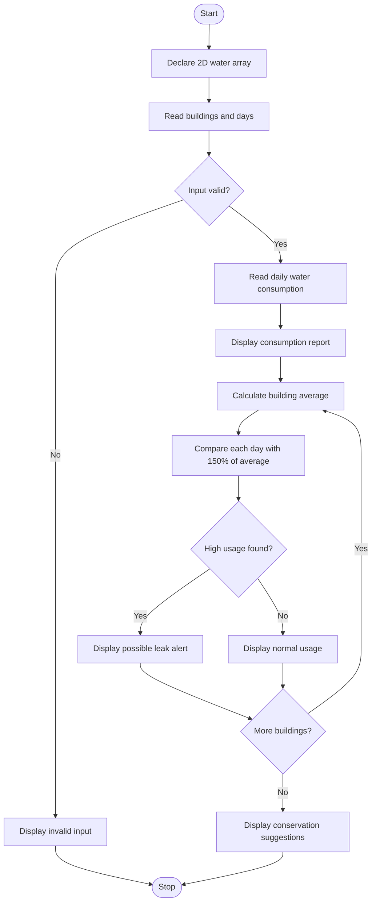

# CODE2THINK Challenge 11 - WATERWISE

**Track. Detect. Conserve.**

## Aim

To develop a simple Campus Water Audit and Leak Alert System using two-dimensional arrays, user-defined functions, and pointers in C. The program records daily water consumption, identifies unusually high usage, and suggests practical water-conservation measures.

## Algorithm

1. Start the program.
2. Declare a two-dimensional array to store water consumption.
3. Read the number of buildings and days, then validate them.
4. Read the daily water consumption for every building.
5. Display the entered consumption data.
6. For each building, calculate the average consumption using `calculateAverage()`.
7. Compare each day's consumption with 150% of that building's average using `detectLeak()`.
8. Display a possible leak alert when a reading is unusually high; otherwise, display a normal-usage message.
9. Display water-saving suggestions.
10. Stop the program.

## Flowchart



## Compile and run

With GCC:

```sh
gcc -std=c11 -Wall -Wextra -pedantic Challenge-11.c -o Challenge-11
./Challenge-11
```

On Windows after compiling:

```powershell
.\Challenge-11.exe
```

## Sample output

```text
===== WATERWISE =====
Campus Water Audit System

Enter number of buildings (1-5): 2
Enter number of days (1-7): 3

Enter water consumption for Building 1:
Day 1 (in litres): 100
Day 2 (in litres): 120
Day 3 (in litres): 300

Enter water consumption for Building 2:
Day 1 (in litres): 200
Day 2 (in litres): 210
Day 3 (in litres): 190

--- WATER CONSUMPTION REPORT ---

Building 1: 100 120 300
Building 2: 200 210 190

--- WATER AUDIT RESULTS ---

Building 1 Average: 173.33 litres
Leak Analysis:
Possible leak detected on Day 3!

Building 2 Average: 200.00 litres
Leak Analysis:
No unusual water consumption detected.

--- WATER SAVING SUGGESTIONS ---
1. Repair leaking taps and pipes.
2. Avoid unnecessary water usage.
3. Monitor daily water consumption.
4. Reuse water wherever possible.

===== AUDIT COMPLETED =====
```

## Concepts used

| Concept | Application in WATERWISE |
|---|---|
| Two-dimensional array | `water[BUILDINGS][DAYS]` stores daily consumption for several buildings. |
| User-defined functions | `calculateAverage()`, `displayData()`, and `detectLeak()` divide the program into clear tasks. |
| Pointers | `int *water` receives a building row. `*(water + i)` accesses each day's value through pointer arithmetic. |
| Loops | Nested loops collect and display readings; loops also analyse each building. |
| Conditional statements | An alert is shown when usage is greater than 150% of the average. |

## Result

The WATERWISE program successfully records and analyses campus water consumption. It calculates building-wise average use, flags unusually high readings as possible leak alerts, and provides water-saving suggestions.

> This is a basic educational model. A high reading is only a possible leak warning, not proof of a leak. The 150% threshold is a simple demonstration rule.
